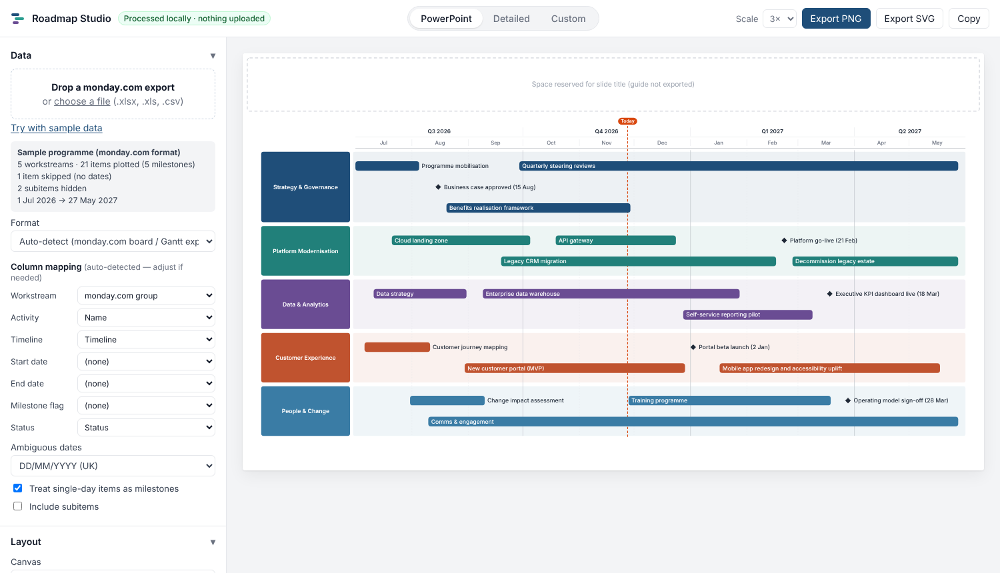

# Roadmap Studio

A small, fully local HTML app that turns **monday.com Excel/CSV exports** into clean, presentation-ready roadmap graphics.

- **No server, database, login or cloud.** Open `index.html` in a browser. That's it.
- **Your data stays on your machine.** Files are parsed in the browser tab with a bundled copy of SheetJS. The page's Content-Security-Policy blocks all network requests (`connect-src 'none'`).
- **Export** high-resolution PNG (up to 4×, i.e. 7680×4320 for a slide), SVG, or copy straight to the clipboard for pasting into PowerPoint.



## Quick start

1. Download or clone this repository.
2. Double-click `index.html` (Chrome, Edge, Firefox or Safari).
3. In monday.com, open your board or Gantt view and choose **Export → Export to Excel** (CSV works too).
4. Drag the file onto the page, or click **Choose a file**.
5. Pick a preset, adjust the look, then **Export PNG** / **Export SVG** / **Copy**.

You can try it without your own data: click **Try with sample data**, or load one of the files in `samples/`. `samples/Example-Monday.com.xlsx` is a real (anonymised) monday.com export.

## What it detects automatically

| Roadmap element | How it is found |
| --- | --- |
| **Workstreams** | monday.com groups (the group title rows in a board export), or a column such as *Workstream, Group, Phase, Programme, Project, Team, Epic*. |
| **Activities** | The *Name / Item / Task / Activity* column. |
| **Dates** | monday.com *Timeline - Start* / *Timeline - End* columns (the usual Excel export), a combined *Timeline* column (`2025-01-06 - 2025-02-14`), or *Start* / *End / Due / Finish* columns. A single *Date* column is used when an item has no timeline. Excel serial dates (with or without date formatting), ISO, UK (`14/03/2025`), US and written dates (`14 Mar 2025`) are supported. |
| **Milestones vs bars** | An item whose start and end are the **same day** (or that only has a single date) is drawn as a milestone ◆. Anything longer is an activity bar. You can also map a column containing "milestone" to flag items explicitly. |
| **Status** | A *Status / RAG / Health* column, used for optional colour-by-status. |
| **Subitems** | monday.com subitem blocks are recognised. *Auto* (the default) shows subitems only where the parent item has no dates of its own, and draws that parent as a summary bar spanning its subitems. *Always show* draws every subitem as a slimmer, lighter bar beneath its parent. *Hide* leaves them out. |

When you load a file, the app tries **every sheet with every format** (monday.com board layout or a plain table) and keeps the combination that plots the most activities. Extra cover sheets, data starting in column B, a renamed *Name* column, Excel-saved files and CSV exports all load without changes.

Everything detected can be overridden in the **Data → Column mapping** panel. **Preview of the data read** shows the first rows as the app understood them. Items without dates are skipped and counted in the file summary. If nothing can be plotted, the page explains why and offers a **Copy these details** button. It copies only column titles and a few date values, never activity names, so you can share it when reporting a problem.

## Presets

| Preset | Use it for |
| --- | --- |
| **PowerPoint** | A 1920×1080 (16:9) image with the top 15% kept free for the slide title. Rows share lanes where possible and the layout auto-fits to the slide: it grows rows to fill the space or shrinks text when there is a lot of content. Drop the PNG/SVG onto a full slide and type the title in PowerPoint's own title placeholder. |
| **Detailed** | One activity per row with dates on each bar. The height grows to fit everything, which suits appendices, documents and handouts. |
| **Custom** | Any change to a layout control switches here, so you can always go back to a clean preset. |

## Controls

- **Layout:** canvas (16:9 slide or auto height), title space, fit to slide, optional title inside the image, font, font size, row height, bar thickness, workstream spacing, margins, compact or one-per-row packing.
- **Workstreams:** heading style (coloured band on the left with centred text, or a centred heading row), band width, heading size, tinted rows. Show, hide, reorder and recolour individual workstreams.
- **Items with subitems:** a parent and its subitems are kept together as a group. A thin **summary line** with end ticks runs along the parent's row from the earliest to the latest subitem. A milestone parent sits on that line, so you can see which work leads up to it. **Group style** sets how the group is tied together: an outline, connector lines (tree), a side rail in the margin, a shaded band behind the rows, or none. See `docs/subitem-group-styles.png` for a comparison.
- **Date range and timescale:** automatic or custom months; weeks, months or quarters (automatic by default). Plans shorter than about four months snap to whole weeks so short timelines use the full width.
- **Labels:** activity labels on or off, position (*Auto* puts the label inside when it fits and beside the bar when it doesn't; you can also choose *Always beside* or *Always inside*), dates on activities and milestones.
- **Milestones:** show or hide, inline or a *Key milestones* row at the top, size, colour.
- **Today marker:** show or hide, label, colour, date override.
- **Colours:** palettes (Executive, Muted, Vibrant, Ocean, Slate), colour by status with a legend, background, text and gridline colours.

Layout and colour preferences are remembered in your browser's local storage. Nothing from your file is stored there, including the title, workstream names and per-workstream colours. **Reset all settings** clears the saved preferences.

### Label readability

Labels inside a bar get black or white text, whichever contrasts more with that bar. Labels that don't fit go beside the bar in the page text colour. They move to the left of the bar near the right edge, and are truncated only as a last resort. If you pick a text colour that wouldn't show up on your background, the app switches to one that does. You never get white text on a white background.

## Project structure

```
index.html                 App shell; scripts load as plain <script> tags so file:// works
css/app.css                UI styling
vendor/xlsx.full.min.js    SheetJS (bundled, Apache-2.0; see vendor/xlsx.LICENSE)
js/core/util.js            Dates (time-zone-safe day numbers), colours/contrast, text measuring
js/core/reader.js          File → sheets (array of rows) via SheetJS
js/core/mapping.js         Column auto-detection and the roadmap model builder
js/core/loader.js          Tries every sheet x adapter and keeps the best result
js/adapters/registry.js    Export-format adapter registry
js/adapters/monday-board.js  monday.com board/Gantt export (groups, repeated headers, subitems)
js/adapters/generic-table.js Any single-header table (CSV lists, other tools)
js/presets/presets.js      Default style, presets, palettes, status colours
js/render/roadmap-svg.js   Layout and SVG rendering (pure: model + style → SVG string)
js/export/exporter.js      SVG / PNG / clipboard export
js/app.js                  UI wiring
samples/                   Sample data (built-in, .xlsx and .csv)
tests/                     Parser unit tests and a headless smoke test
```

The data flow: **file → sheets → adapter → flat table → column mapping → model → SVG → export.**

### Adding a new export format

Create `js/adapters/my-format.js` and include it in `index.html` after `registry.js`:

```js
RM.adapters.register({
  id: 'my-format',
  label: 'My tool export',
  detect(rows) { return /* 0..1 confidence */ 0; },
  toTable(rows) {
    return { columns: [...], rows: [{ __group: 'Workstream', Name: '...', Timeline: '...' }], meta: { title: null, groupsDetected: true } };
  },
});
```

The adapter with the highest `detect` score is used, and users can override the choice in the **Format** drop-down.

### Adding a styling preset

Add a `RM.presets.register({ id, label, description, style: { ...partial style... } })` call (see `js/presets/presets.js` for all keys). It appears in the preset bar automatically.

## Development

There's no build step. To run the checks:

```bash
node tests/parse.test.js          # parser / detection unit tests (Node only), incl. export variants
node tests/make-fixtures.js       # regenerate the export-variant fixtures in tests/fixtures/
node tests/smoke.js               # headless browser test (needs Playwright installed)
```

The smoke test opens `index.html` from disk, loads every sample, renders each preset, and exports PNG and SVG. It fails if the page makes any network request.

### SheetJS version

`vendor/xlsx.full.min.js` is the official SheetJS Community Edition **0.18.5** from npm. SheetJS now publishes newer releases (0.20.x) only on `cdn.sheetjs.com`. To upgrade, download `xlsx.full.min.js` from there and replace the vendored file, since the API is the same. 0.18.5 has published advisories that only matter when parsing untrusted, maliciously crafted files. Here you open your own exports locally, so the risk is low, but upgrading is still recommended.

## Privacy

- Nothing is uploaded: files are read with the browser's `FileReader` and processed in memory.
- The page's CSP blocks `fetch`/XHR/WebSocket (`connect-src 'none'`) and external scripts.
- Only layout and colour preferences are saved in local storage. Nothing from your file is stored, including the title and workstream names. Saved values are validated when loaded, so tampered storage can't inject content into the page.
- A security review is in `docs/SECURITY.md`.
